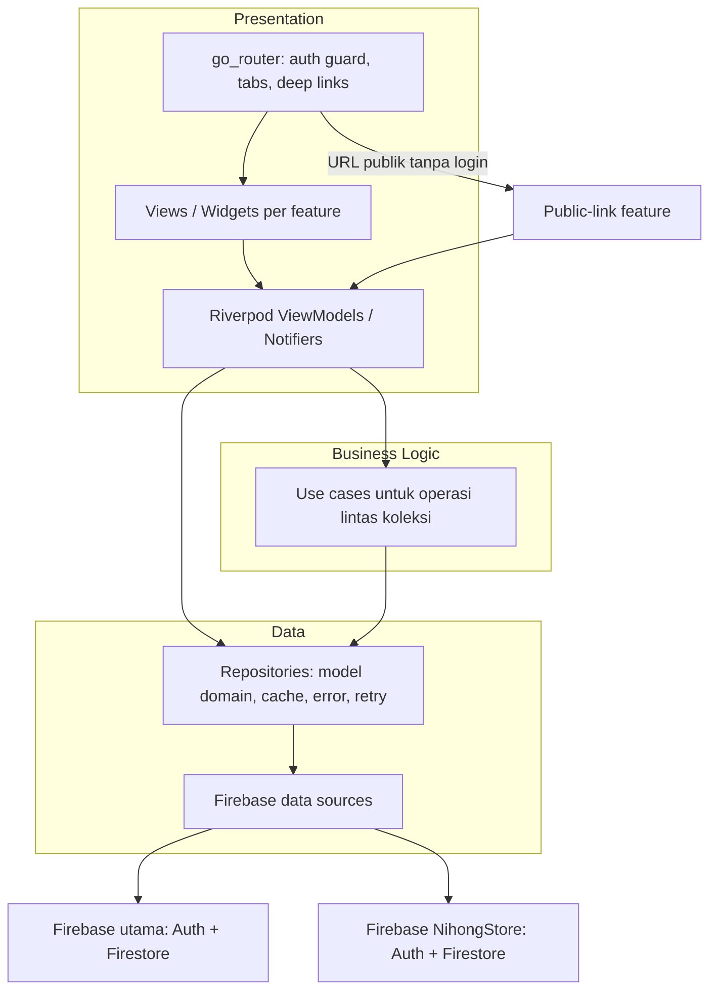

# Arsitektur Mobile Flutter — Nihong Jastip

## 1. Tujuan dan keputusan utama

Dokumen ini menjadi rancangan untuk aplikasi Android/iOS yang berjalan bersama workspace web Nihong Jastip saat ini.

- Buat aplikasi Flutter sebagai repository/proyek terpisah yang berdampingan dengan repository web, misalnya `nihong-mobile/` di sebelah `nihong-team/`. Jangan letakkan source Flutter di dalam repository web ini.
- Gunakan Firebase project dan koleksi Firestore yang sama dengan web agar kedua klien beroperasi pada data yang sama. Pertahankan nama field, tipe nilai, status, dan ID dokumen yang sudah dipakai.
- Gunakan arsitektur feature-first dengan pemisahan **View → ViewModel → Repository → Service/Data source**. Tambahkan use case hanya untuk alur lintas koleksi atau aturan yang kritis.
- Rekomendasi state dan dependency injection: `flutter_riverpod`; navigasi dan deep link: `go_router`.
- Aplikasi ini berfokus pada operasional admin/jastiper. Link publik pelanggan tetap dapat dibuka tanpa login, melalui web fallback atau route Flutter.

Pola ViewModel/repository/service mengikuti panduan arsitektur Flutter. Riverpod cocok untuk state `Future`/`Stream`, dependency injection, dan penanganan error. `go_router` mendukung redirect berdasarkan sesi dan shell dengan navigasi tab.

## 2. Sistem yang sudah ada

Web adalah SPA React 18 + TypeScript + Vite, juga dipasang sebagai PWA. Data utama disimpan langsung di Cloud Firestore dan autentikasi menggunakan Firebase Authentication email/password. Fitur operasional yang perlu dipetakan ke mobile:

- Dashboard dan ringkasan pembayaran.
- Pesanan resmi (`orders`), DP, pelunasan, invoice, pencarian/filter.
- Pre-order/booking (`pre_orders`), item belanja, status `Pending`/`Selesai`, konversi menjadi pesanan.
- Jadwal keberangkatan (`departure_schedules`) dan kapasitas bagasi.
- Pelanggan (`customer`), jastiper, kas (`ledger`) dan audit.
- Inbox NihongStore dari Firebase project kedua `nihongstore-6210b`, koleksi `nihongstore_orders`.
- Portal publik untuk produk booking, alamat pengiriman, pratinjau jadwal, dan laporan kas.

Web melakukan autentikasi ke Firebase utama lalu mencoba autentikasi dengan kredensial yang sama ke Firebase NihongStore. Akun kedua harus terdaftar pada `admins/{uid}`. Jika login kedua gagal, implementasi web saat ini membatalkan login utama. Arsitektur mobile harus mempertahankan perilaku ini sampai kebijakan akses NihongStore diputuskan ulang.

## 3. Arsitektur aplikasi



### Tanggung jawab tiap lapisan

| Lapisan | Tanggung jawab | Contoh |
|---|---|---|
| View | Render state, layout responsif, input sederhana | `OrdersScreen`, `BookingDetailScreen` |
| ViewModel | State layar, filter, validasi UI, perintah pengguna | `OrdersViewModel`, `BookingFormViewModel` |
| Use case | Aturan alur yang menyentuh beberapa model/koleksi | `ConvertPreOrderToOrder`, `SavePublicBookingProducts` |
| Repository | Sumber kebenaran aplikasi; mapping model, error, cache, retry | `PreOrderRepository`, `LedgerRepository` |
| Data source/service | Membungkus API Firebase dan mengembalikan `Future`/`Stream` | `FirestorePreOrderDataSource` |

View tidak memanggil Firebase langsung. Query dan write Firestore berada di data source/repository. Perhitungan harga, payment summary, validasi tanggal dan aturan item publik harus menjadi Dart function/use case yang dapat diuji terpisah dari widget.

### Usulan struktur folder

```text
nihong-mobile/                         # root repository Flutter terpisah
├── pubspec.yaml
├── android/                         # konfigurasi native Android dan App Links
├── ios/                             # konfigurasi native iOS dan Universal Links
└── lib/
    ├── main.dart
    ├── app/
    │   ├── app.dart
    │   ├── bootstrap.dart            # Firebase, ProviderScope, konfigurasi awal
    │   └── router.dart
    ├── core/
    │   ├── firebase/                 # main app + FirebaseApp NihongStore
    │   ├── config/                   # flavor dev/prod
    │   ├── design_system/            # warna, typography, komponen bersama
    │   ├── errors/
    │   ├── formatting/               # IDR/JPY, tanggal aman, nomor WhatsApp
    │   └── widgets/
    └── features/
        ├── auth/{data,domain,presentation}/
        ├── dashboard/{data,domain,presentation}/
        ├── orders/{data,domain,presentation}/
        ├── pre_orders/{data,domain,presentation}/
        ├── schedules/{data,domain,presentation}/
        ├── customers/{data,domain,presentation}/
        ├── ledger/{data,domain,presentation}/
        ├── jastipers/{data,domain,presentation}/
        ├── nihong_store/{data,domain,presentation}/
        ├── public_links/
        │   ├── booking_products/
        │   ├── delivery_address/
        │   ├── schedule_share/
        │   └── ledger_report/
        └── settings/{data,domain,presentation}/
```

Dokumen arsitektur ini tinggal di repository web sebagai referensi integrasi. Repository Flutter berdiri sendiri; kedua proyek hanya berbagi kontrak Firestore/Firebase dan skema link publik, bukan source code atau toolchain.

Di dalam feature, gunakan nama file yang eksplisit, misalnya `orders_repository.dart`, `firestore_orders_data_source.dart`, `orders_view_model.dart`, dan `orders_screen.dart`. Model Firestore/DTO berada di `data/models`; model domain berada di `domain/models` bila bentuknya berbeda dari dokumen Firestore.

## 4. Navigasi dan peta layar

Gunakan shell dengan stack terpisah per tab. Pada ponsel, tampilkan empat tab utama: **Beranda**, **Pesanan**, **Booking**, dan **Menu**. Jadwal dan Kas dapat diakses dari Menu atau shortcut di Beranda. Tombol aksi cepat untuk membuat pesanan, booking, jadwal, atau transaksi kas tetap tersedia tanpa memenuhi bottom navigation.

| Area | Route Flutter (usulan) | Fitur utama |
|---|---|---|
| Login | `/login` | Email/password, status login utama dan NihongStore |
| Beranda | `/` | Ringkasan order, pembayaran, jadwal aktif, aksi cepat |
| Pesanan | `/orders`, `/orders/:id` | Cari/filter, detail, pembayaran bertahap, invoice |
| Booking | `/preorders`, `/preorders/:id` | Pending/Selesai, item, checklist jastiper, konversi |
| Jadwal | `/schedules`, `/schedules/:id` | Rute, tanggal, jastiper, kapasitas dan booking terkait |
| Pelanggan | `/customers`, `/customers/:id` | Profil, telepon, alamat Indonesia/Jepang |
| Kas | `/cash` | Masuk/keluar, filter, saldo, audit, modal belanja |
| NihongStore | `/inbox` | Inbox, cek stok, assign ke jadwal/booking |
| Jastiper & alat | `/jastipers`, `/jastiper-search`, `/whatsapp-templates` | Direktori, pencarian eksternal, draft pesan |

### Deep link publik

Pertahankan URL yang sudah dibagikan agar link WhatsApp lama tetap berfungsi. `go_router` membaca query parameter dan mengarahkan ke layar tanpa login:

| URL web saat ini | Route/halaman Flutter |
|---|---|
| `/?products=<token>` | Form daftar/revisi barang booking |
| `/?delivery=<token>` | Form alamat pengiriman satu kali |
| `/?share=<scheduleId>` | Pratinjau jadwal dan pre-order terkait |
| `/?share_ledger=<token>` | Laporan kas snapshot yang dibagikan |

Konfigurasikan Android App Links dan iOS Universal Links untuk domain produksi; browser menjadi fallback bila aplikasi belum terpasang. Token tidak boleh masuk ke analytics, crash logs, atau log navigasi. Halaman publik tidak boleh mewarisi stream admin atau mengaktifkan listener koleksi global.

## 5. Kontrak data bersama

Versi pertama mobile sebaiknya membaca/menulis kontrak Firestore yang ada, bukan membuat koleksi duplikat. Buat mapper Dart eksplisit dan toleran terhadap bentuk legacy yang memang sudah ada di data.

| Koleksi/dokumen | Model dan invariants penting |
|---|---|
| `orders/{id}` | `OrderDoc`: tanggal `YYYY-MM-DD`, mata uang `tipeNominal`, nominal, status `Belum Membayar`/`DP Terbayar`/`Selesai`, revision untuk edit bersamaan |
| `pre_orders/{id}` | `PreOrder`: `idJadwal`, `idPelanggan`, daftar `items`, `totalKg`, status `Pending`/`Selesai`, token share |
| `departure_schedules/{id}` | `DepartureSchedule`: rute, tanggal berangkat/last drop, `slotBeratKg`, `beratTerpakai`, status `Open`/`Closed` |
| `customer/{id}` | `Customer`: nama, telepon, alamat Indonesia/Jepang; nama dinormalisasi uppercase |
| `jastipers/{id}` | Profil jastiper; cocokkan field legacy dengan mapper sebelum implementasi |
| `ledger/{id}` | `Masuk`/`Keluar`, tanggal kalender lokal, jumlah rupiah positif, revision dan void fields |
| `ledger_audit/{id}` | Sebelum/sesudah untuk create/update/void/restore; catat actor |
| `metadata/ledger_summary` | Cache ringkasan saldo dan revision; bukan sumber transaksi utama |
| `ledger_reports/{token}` | Snapshot publik terbatas, waktu kedaluwarsa, status revoke |
| `booking_product_links/{token}` | Pemetaan token ke booking dan customer |
| `delivery_address_links/{token}` | Pemetaan token sekali pakai ke booking, customer, rute dan negara |
| Project NihongStore: `nihongstore_orders/{id}` | Inbox toko dan timeline; hanya diakses lewat Firebase app kedua |

Field waktu Firestore saat ini tidak sepenuhnya seragam (misalnya server timestamp, epoch milliseconds, dan string tanggal). Jangan parse semua nilai sebagai satu tipe tanpa mapper. Untuk tanggal kalender `YYYY-MM-DD`, pecah tahun/bulan/hari menjadi komponen lokal; jangan langsung memakai parser UTC yang dapat menggeser hari. Tampilan tanggal pelanggan memakai nama bulan penuh Bahasa Indonesia. Nilai uang tetap berupa bilangan dan mata uang IDR/JPY tidak dicampur dalam satu invoice.

## 6. Alur bisnis yang wajib dipertahankan

1. **Buat/ubah pre-order**: booking menyumbang `totalKg` terhadap kapasitas jadwal. Status `Selesai` tetap memakai kapasitas sampai booking dihapus; perubahan jadwal/berat mengubah kontribusi kapasitas.
2. **Checklist barang**: perubahan `checked` adalah tindakan operasional admin/jastiper. Konversi booking ke pesanan menandai item sudah dibeli dan mempertahankan kontribusi berat pada jadwal.
3. **Konversi booking → order**: jalankan validasi dan write order, status booking, summary bulanan, dan agregat pelanggan sesuai transaksi yang ada. Sinkronisasi timeline NihongStore saat ini merupakan langkah lintas Firebase terpisah dan best-effort; tampilkan status sinkronisasi/error dengan jelas.
4. **Pembayaran order**: pertahankan revision/concurrency check, kalkulasi total/markup, DP dan pelunasan. Ringkasan pembayaran yang sama harus dipakai di detail, invoice, dan dashboard.
5. **Kas**: hanya payload transaksi yang diizinkan; perubahan harus menulis audit dan mengubah summary secara konsisten. Void/restore tidak menghapus sejarah.
6. **Produk publik**: token 48 karakter lowercase hex dari 24 byte acak; simpan mapping pada `booking_product_links`. Simpan memakai transaction dan `productRevision`; hanya field produk yang boleh diubah pelanggan. Item `checked: true` terkunci. Booking selain `Pending` read-only.
7. **Alamat publik**: token 48 karakter pada `delivery_address_links`, verifikasi mapping terhadap booking/customer, validasi field alamat menurut Jepang/Indonesia, dan hanya terima satu submit.
8. **Laporan kas publik**: hanya bagikan snapshot field yang di-whitelist; jangan sertakan catatan internal, rekening, audit, atau saldo global. Periksa masa berlaku/revoke dari server sebelum menampilkan snapshot.

### Catatan konsistensi kapasitas

Implementasi web `addPreOrder` saat ini menulis `pre_orders`, lalu memperbarui berat jadwal sebagai operasi terpisah. Rancangan mobile harus menutup celah kegagalan parsial sebelum dipakai lintas perangkat. Pilihan yang disarankan adalah menyatukan perubahan booking dan kapasitas dalam transaction/callable server operation. Perubahan ini perlu diterapkan atau diselaraskan juga pada web; transaksi yang hanya dipakai Flutter tidak mencegah klien web lama menulis dengan protokol berbeda. Jika perubahan kedua klien belum masuk scope, dokumentasikan sebagai risiko rilis dan buat operasi mobile idempotent dengan penanganan retry/kompensasi.

## 7. Keamanan, sesi, dan offline

- Lindungi seluruh layar operasional dengan Firebase Auth state. Otorisasi final harus ditegakkan oleh Firestore Security Rules/backend, bukan hanya visibilitas tombol atau validasi Dart.
- Aturan publik wajib sama ketatnya dengan AGENTS.md: token acak 48 karakter lowercase hex tervalidasi `/^[a-f0-9]{48}$/`, mapping terpisah, strict field whitelist, barang checked immutable, revision + Firestore transaction, mode read-only ketika status booking bukan `Pending`, dan hanya listen dokumen yang lolos verifikasi token.
- Jangan pernah membuka stream global `pre_orders` atau `customer` dari layar publik. Mulai dari dokumen mapping token yang valid, lalu baca/listen hanya booking terkait.
- App login utama dan NihongStore memakai dua `FirebaseApp`/`FirebaseAuth` terpisah. Simpan konfigurasi Firebase per environment lewat FlutterFire; jangan menaruh password atau credential admin di aplikasi.
- Di repo terdapat `firestore/ledger.rules` untuk akses laporan kas publik dan aktivasi fitur dikendalikan konfigurasi web. Sebelum mengaktifkan route kas publik dari Flutter, verifikasi rules yang benar sudah dipasang pada project dan pertahankan default nonaktif sampai siap.
- Firestore native menyediakan cache offline; tandai data dari cache/stale pada layar operasional. Transaction Firestore tidak dapat diselesaikan saat perangkat offline, jadi aksi konversi, penyimpanan produk publik, alamat satu-kali, dan perubahan kas harus memerlukan koneksi dan menampilkan retry yang jelas. Jangan anggap write yang tertunda sebagai keberhasilan final.
- FCM web saat ini menyimpan token pada `fcm_tokens/{uid}` dengan platform `web`. Push native perlu token per instalasi/platform dan lifecycle refresh/unregister; jangan menimpa token web dengan token ponsel pada dokumen yang sama. Pertimbangkan subkoleksi `fcm_tokens/{uid}/devices/{installationId}` setelah kontrak pengiriman server disiapkan.

Sebelum rilis, audit rules untuk seluruh koleksi yang diakses klien mobile. Dalam inventaris repository, file rules yang ditemukan adalah `firestore/ledger.rules`; rules operasional lainnya perlu dikonfirmasi dari konfigurasi/deployment Firebase.

## 8. Desain mobile

Gunakan token resmi yang sudah didefinisikan proyek: navy `#0B2545`, navy gelap `#071B33`, orange `#F26522`, background `#F4F6F8`, card `#FFFEFC`, border `#DDE3EA`. Buat Material theme token terpusat agar konsisten dengan web.

- Rancang mobile-first: area sentuh minimal 44 px dan font input 14–16 px atau lebih besar.
- Jadikan daftar data mudah dipindai: status badge, nama pelanggan, tanggal, ringkasan uang/berat; detail dan formulir dibuka sebagai halaman/sheet native.
- Buat state loading, kosong, error, offline, dan sukses eksplisit; gunakan konfirmasi untuk hapus/void/konversi.
- Pertahankan animasi singkat hanya untuk transisi penting; hormati reduced motion.
- Untuk Threads, buka URL pencarian dengan `filter=recent` dan tampilkan petunjuk bahwa aplikasi Threads di ponsel dapat mendarat di tab **Top**, sehingga pengguna perlu memilih **Recent/Terbaru**.
- Normalisasi nomor WhatsApp menjadi `62...`, lalu buka `https://wa.me/<nomor>?text=<pesan-terenkode>` melalui `url_launcher`.

## 9. Dependensi Flutter yang disarankan

Mulai dengan dependensi berikut; pilih versi yang kompatibel saat pembuatan project, jangan menyalin versi package dari dokumen ini.

| Kebutuhan | Package/alat |
|---|---|
| Firebase init/auth/Firestore | FlutterFire CLI, `firebase_core`, `firebase_auth`, `cloud_firestore` |
| State + dependency injection | `flutter_riverpod` |
| Navigation/deep links | `go_router` |
| Format Bahasa Indonesia | `flutter_localizations`, `intl` |
| Buka WhatsApp/Threads/link | `url_launcher` |
| Share file/link | `share_plus` |
| Push native (tahap lanjutan) | `firebase_messaging` |
| Invoice PDF/print (tahap lanjutan) | `pdf`, `printing` |

FlutterFire CLI menghasilkan konfigurasi platform (`firebase_options.dart`). Firebase NihongStore perlu opsi terpisah untuk project kedua dan instance bernama, misalnya `nihongStoreApp`, lalu repository menggunakan Auth/Firestore dari instance itu.

## 10. Langkah pengerjaan bertahap

Kerjakan satu langkah sampai checkpoint-nya lolos sebelum menambah fitur berikutnya. Tiap langkah membangun satu potongan yang bisa dijalankan dan ditinjau.

### Langkah 0 — pastikan prasyarat dan batas proyek

1. Pilih target awal: Android saja untuk prototipe, atau Android + iOS untuk rilis pertama.
2. Tentukan nama aplikasi, Android application ID, dan iOS bundle ID.
3. Pastikan Firebase project utama, Firebase NihongStore, akun admin, dan akses Firebase Console tersedia.
4. Minta/konfirmasi Firestore Rules yang benar-benar aktif untuk koleksi operasional. Inventaris repo hanya menemukan `firestore/ledger.rules`; aturan lain perlu dicek pada konfigurasi/deployment Firebase.
5. Putuskan apakah seluruh pengguna mobile wajib lolos login NihongStore seperti web sekarang.
6. Sepakati cara menyelaraskan operasi kapasitas booking di web dan mobile agar tidak terjadi update parsial.

**Checkpoint:** keputusan dan akses di atas tercatat; belum ada perubahan database produksi.

### Langkah 1 — siapkan toolchain dan folder Flutter terpisah

1. Jalankan `flutter doctor` dan bereskan kebutuhan platform yang dipilih.
2. Buat repo Flutter sebagai sibling repo web. Contoh lokasi: `/Users/CANDY/Projects/Pribadi/nihong-mobile`, sejajar dengan `nihong-team`.
3. Inisialisasi app Flutter di folder baru:

   ```bash
   cd /Users/CANDY/Projects/Pribadi
   flutter create --platforms=android,ios nihong-mobile
   ```

4. Inisialisasi Git dan commit scaffold Flutter secara terpisah dari repo web.

**Checkpoint:** `flutter run` berhasil membuka counter app bawaan pada emulator/perangkat; repository web tidak berubah.

### Langkah 2 — sambungkan Firebase development

1. Buat/daftarkan aplikasi Android dan iOS di Firebase project utama yang sama dengan web. Jangan membuat koleksi atau project data baru untuk mobile.
2. Jalankan FlutterFire CLI dari root `nihong-mobile` dan pilih platform/project yang sesuai.
3. Simpan `firebase_options.dart` sebagai konfigurasi client; jangan memasukkan password admin, service account, atau token privat.
4. Pasang `firebase_core`, `firebase_auth`, dan `cloud_firestore`; inisialisasi Firebase sebelum `runApp`.
5. Sambungkan emulator Firebase untuk development bila tersedia, agar uji awal tidak menulis ke data produksi.

**Checkpoint:** app menampilkan project ID development yang benar dan dapat membaca dokumen uji yang memang diizinkan.

### Langkah 3 — buat kerangka aplikasi dan tema

1. Tambahkan `flutter_riverpod`, `go_router`, dan `intl`.
2. Buat `ProviderScope`, konfigurasi router, halaman login kosong, shell tab, serta halaman error/404.
3. Pusatkan warna brand, typography, tombol, input, badge status, card, dan loading state di `core/design_system`.
4. Tambahkan lint/format Dart dan struktur feature-first dari bagian 3.

**Checkpoint:** aplikasi bisa dibuka ke shell setelah login mock; route publik dan route admin sudah terpisah di konfigurasi, belum terhubung ke data nyata.

### Langkah 4 — model dan mapper Firestore

1. Buat model Dart terlebih dahulu untuk `Customer`, `DepartureSchedule`, `PreOrder`, `OrderDoc`, dan `LedgerEntry`.
2. Tulis mapper `fromFirestore`/`toFirestore` eksplisit. Jangan mengirim field yang tidak dimiliki form.
3. Tangani timestamp lama (server timestamp, angka epoch, atau string) dan field opsional tanpa merusak dokumen legacy.
4. Implementasikan parser tanggal `YYYY-MM-DD` dengan komponen lokal dan formatter nama bulan penuh Bahasa Indonesia.
5. Port kalkulasi harga/payment dari `src/utils/payment.ts` dan `src/utils/helpers.ts` sebagai fungsi Dart murni.

**Checkpoint:** fixture dokumen contoh dari web berhasil di-decode/encode tanpa mengubah nama field, status, mata uang, atau tanggal.

### Langkah 5 — login Firebase utama

1. Buat `AuthRepository` yang membungkus `authStateChanges`, login email/password, dan logout.
2. Buat `AuthViewModel` dengan state loading, signed-in, signed-out, dan error.
3. Hubungkan `go_router` redirect agar seluruh route operasional membutuhkan sesi.
4. Buat halaman login sederhana yang nyaman dipakai di layar ponsel.

**Checkpoint:** login, restart aplikasi dengan sesi tersimpan, logout, dan route guard berfungsi di emulator.

### Langkah 6 — login Firebase NihongStore

1. Daftarkan konfigurasi Firebase project NihongStore secara terpisah.
2. Inisialisasi Firebase app bernama (contoh `nihongStoreApp`) dan ambil instance Auth/Firestore spesifik dari app tersebut.
3. Login dengan kredensial yang sama, lalu validasi dokumen `admins/{uid}` pada project NihongStore.
4. Buat state koneksi NihongStore terpisah supaya error store tidak tercampur dengan status sesi Firebase utama.
5. Pertahankan logout kedua sesi; cocokkan perilaku gagal-login terhadap keputusan pada Langkah 0.

**Checkpoint:** app bisa membedakan main session dan store session serta menampilkan error akses store yang bisa ditindaklanjuti.

### Langkah 7 — buat satu fitur tipis: daftar pelanggan

1. Buat `CustomerDataSource`, `CustomerRepository`, `CustomersViewModel`, lalu `CustomersScreen`.
2. Mulai dari daftar real-time dan detail profil saja.
3. Tambahkan pencarian lokal dan loading/empty/error/offline state.
4. Setelah pembacaan stabil, tambah create/edit dengan normalisasi nama uppercase dan whitelist field.

**Checkpoint:** perubahan dari web muncul di mobile dan perubahan mobile muncul di web; tidak ada field pelanggan tak terkait yang tertimpa.

### Langkah 8 — jadwal dan kapasitas

1. Tampilkan daftar jadwal, status Open/Closed, tanggal berangkat, last drop, kapasitas total/terpakai/sisa.
2. Tambahkan detail jadwal dan daftar pre-order berdasarkan `idJadwal`.
3. Tambahkan form create/edit jadwal.
4. Pastikan tanggal ditampilkan dengan tanggal aman dan nama bulan penuh.

**Checkpoint:** angka kapasitas di mobile sama dengan web pada jadwal yang sama.

### Langkah 9 — booking/pre-order

1. Tampilkan Pending/Selesai, cari booking, dan buka detail items.
2. Tambahkan create/edit booking dan checklist barang admin.
3. Implementasikan perubahan kontribusi kapasitas saat berat atau jadwal berubah.
4. Selaraskan operasi add/edit/delete antara mobile dan web menggunakan transaction/callable server operation atau protokol yang disepakati pada Langkah 0.
5. Tambahkan konversi booking menjadi order dengan idempotency guard dan status progres yang jelas.

**Checkpoint:** pengulangan request tidak membuat booking/order ganda; berat jadwal tetap benar dan barang yang selesai dibeli tetap checked.

### Langkah 10 — pesanan dan pembayaran

1. Tampilkan daftar order dengan filter status, tanggal, dan pelanggan.
2. Buat detail pesanan dengan total, mata uang, pembayaran DP, pelunasan, dan sisa tagihan.
3. Tambahkan create/edit memakai revision dan penanganan konflik edit.
4. Tambahkan catatan pembayaran serta invoice setelah total/payment summary sama dengan hasil web.

**Checkpoint:** uji IDR dan JPY terpisah; DP, pelunasan, edit bersamaan, dan invoice menghasilkan nilai yang sama di web dan mobile.

### Langkah 11 — kas/ledger

1. Pastikan rules produksi dan izin user sudah diaudit.
2. Implementasikan baca ledger dengan pagination/filter dan summary.
3. Tambahkan create/edit sebagai whitelist field; revision, audit, void, restore, dan summary harus satu alur konsisten.
4. Uji konflik dua perangkat dan pemulihan jaringan.

**Checkpoint:** audit menyimpan before/after dan actor; saldo tidak berubah ganda saat retry; transaksi yang di-void tidak masuk saldo aktif.

### Langkah 12 — portal publik dan deep links

1. Daftarkan domain produksi untuk Android App Links dan iOS Universal Links, dengan web sebagai fallback.
2. Implementasikan route pembaca query lama: `products`, `delivery`, `share`, dan `share_ledger`.
3. Implementasikan satu jenis link per iterasi, mulai dari pratinjau jadwal read-only.
4. Lanjutkan produk booking dengan token 48-hex, mapping terpisah, `productRevision`, transaction, whitelist, immutable checked items, dan Pending-only write.
5. Lanjutkan form alamat dengan mapping token dan single-use; terakhir laporan kas snapshot dengan expiry/revoke dan rules yang sudah aktif.
6. Pastikan token tidak muncul pada analytics, error log, atau UI debug.

**Checkpoint:** kasus token invalid, expired, revoked, reused, offline, dan concurrent edit menampilkan state aman; link lama tetap membuka web fallback.

### Langkah 13 — NihongStore inbox dan fitur pelengkap

1. Bangun inbox dari secondary Firestore setelah sesi store aktif.
2. Tambahkan cek stok/ubah status, assign ke jadwal, dan timeline.
3. Tambahkan WhatsApp/Threads melalui deep link yang sudah dinormalisasi.
4. Setelah alur dasar stabil, tambahkan FCM per instalasi, PDF/print, dan export yang paling dibutuhkan tim.

**Checkpoint:** feature store gagal tertutup saat sesi secondary tidak valid; notifikasi satu instalasi tidak menimpa token perangkat lain.

### Langkah 14 — rilis bertahap

1. Jalankan unit test untuk mapper, kalkulasi, parser tanggal, dan aturan whitelist.
2. Jalankan integration test dengan Firebase Emulator untuk auth, transaction, rules, token publik, dan write lintas koleksi.
3. Uji Android/iOS di layar kecil, koneksi lambat, offline, link dari WhatsApp, dan resume setelah aplikasi ditutup.
4. Rilis internal ke tim kecil, cocokkan beberapa hari data web/mobile, baru perluas distribusi.
5. Setiap perubahan schema/rules harus dicatat dan kompatibel dengan versi web yang masih digunakan.

**Checkpoint akhir:** checklist security, data parity, deep link, error recovery, dan persetujuan rilis internal selesai.

## 11. Pemetaan ke kode web

Gunakan sumber ini saat implementasi untuk menjaga parity:

- Entry point, route guard, navigasi dan query share: `src/App.tsx`.
- Model TypeScript: `src/types.ts`.
- Auth utama: `src/services/authFirebase.ts`, `src/context/authContext.tsx`.
- Auth/data NihongStore: `src/services/nihongStoreFirebase.ts`.
- Orders: `src/services/ordersFirebase.ts` dan `src/utils/payment.ts`.
- Pre-order, konversi dan auto-close: `src/services/preOrdersFirebase.ts`.
- Kapasitas/jadwal: `src/services/schedulesFirebase.ts`.
- Produk publik: `src/services/bookingProductsFirebase.ts`, `src/utils/bookingProducts.ts`.
- Alamat publik: `src/services/deliveryAddressFirebase.ts`, `src/utils/deliveryAddress.ts`.
- Kas dan laporan publik: `src/services/ledgerFirebase.ts`, `src/services/ledgerReportsFirebase.ts`.
- Tanggal dan format: `src/utils/format.ts`.

## Referensi platform

- [Flutter app architecture guide](https://docs.flutter.dev/app-architecture/guide)
- [Flutter architecture recommendations](https://docs.flutter.dev/app-architecture/recommendations)
- [FlutterFire setup](https://firebase.google.com/docs/flutter/setup)
- [Firebase Auth for Flutter](https://firebase.google.com/docs/auth/flutter/start)
- [Firestore transactions and batched writes](https://firebase.google.com/docs/firestore/manage-data/transactions)
- [Firestore offline access](https://firebase.google.com/docs/firestore/manage-data/enable-offline)
- [Riverpod providers](https://riverpod.dev/docs/concepts2/providers)
- [go_router package](https://pub.dev/packages/go_router)
